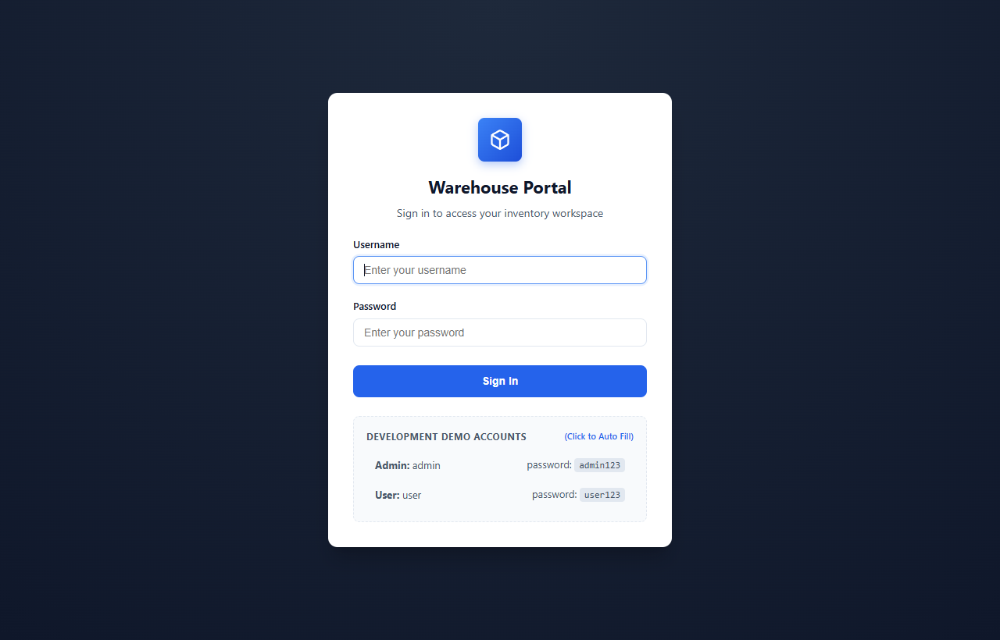
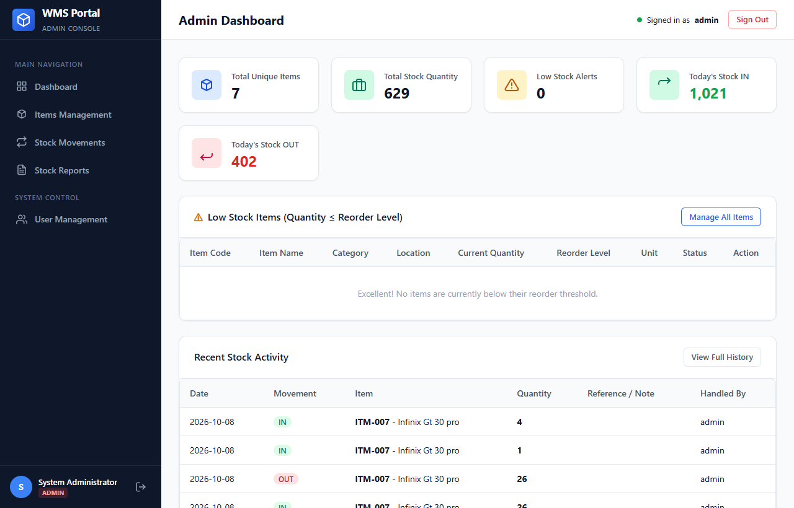
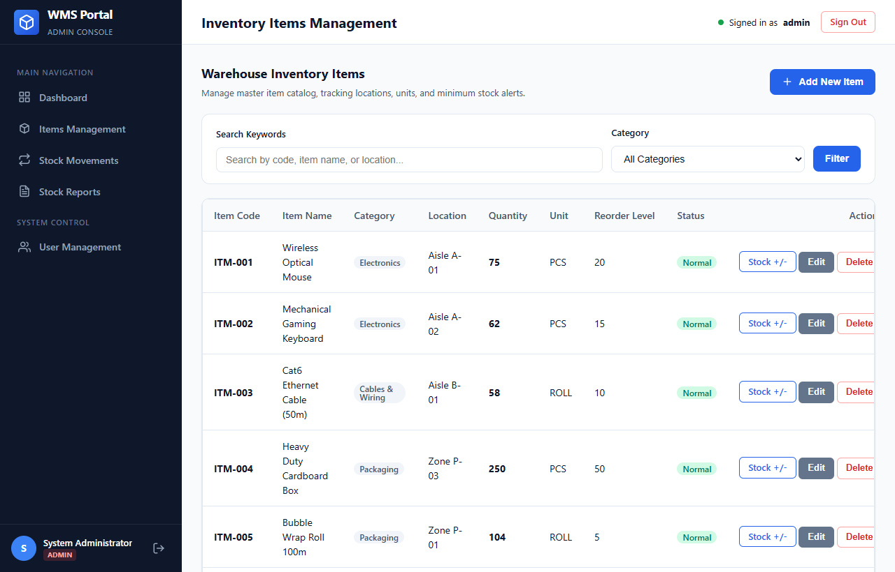
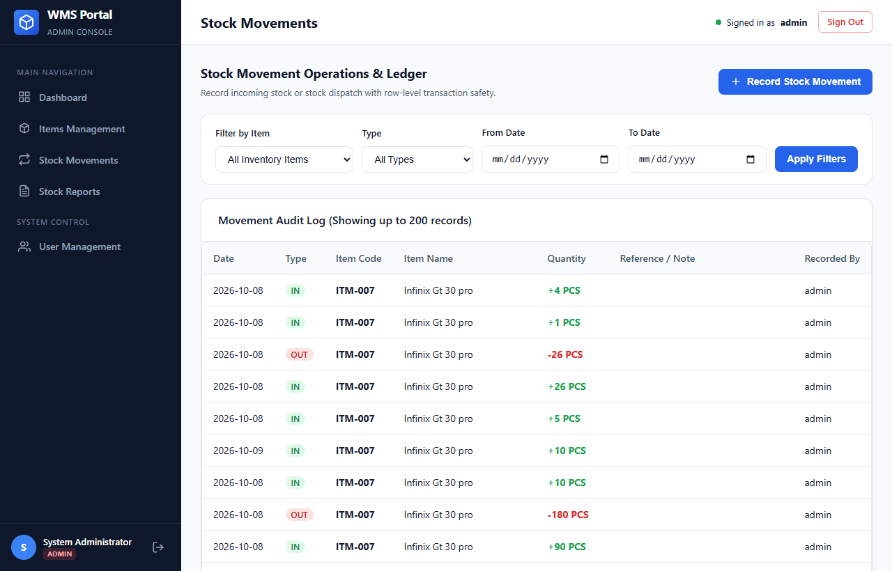
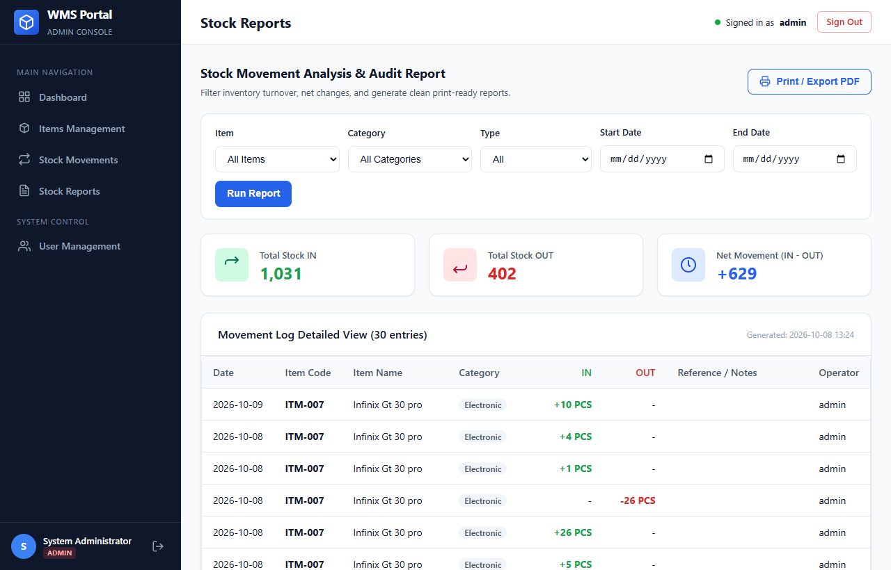
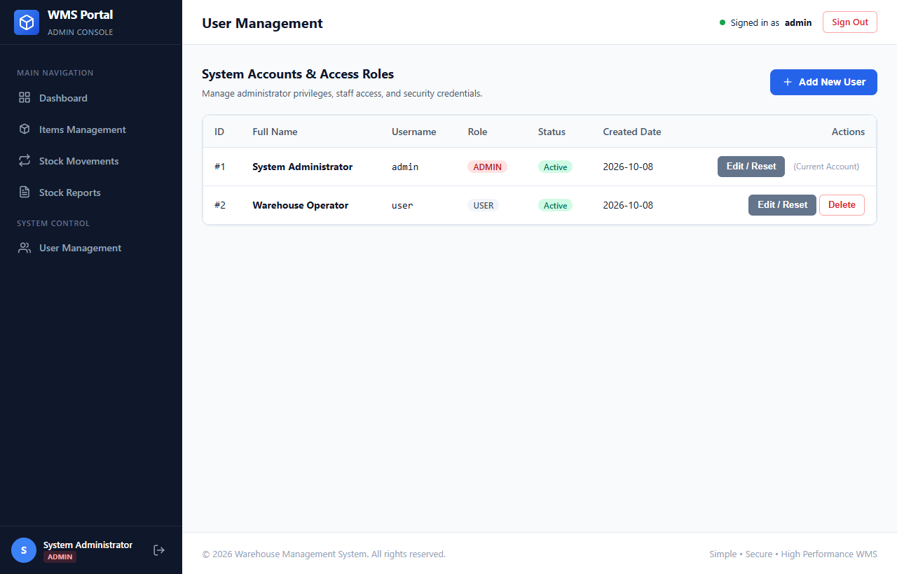
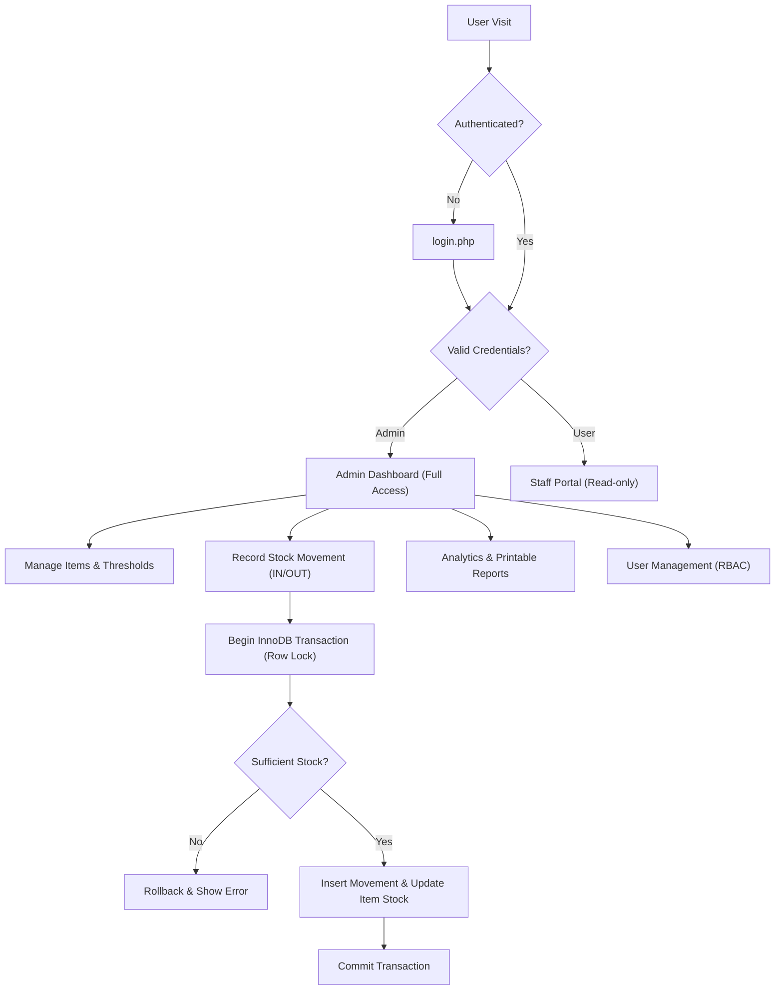

# WarehousePro - Warehouse Management System

A simple, secure, professional, and lightweight Warehouse Management System built using native **PHP 8+**, **MySQL 8+**, **PDO**, **HTML5**, **CSS3**, and **Vanilla JavaScript**.

Designed specifically for **XAMPP** local development environments and **cPanel shared hosting** with zero reliance on heavy frameworks or external npm/composer runtime dependencies.

---

## 快速开始（XAMPP）

1. 把项目放在 `C:\xampp\htdocs\warehouse_management`
2. 启动 XAMPP 的 **Apache** 和 **MySQL**
3. 复制 `config/config.example.php` 为 `config/config.php`，确认数据库账号（默认端口为 `3307` 或 `3306`）
4. 在 phpMyAdmin（http://localhost/phpmyadmin）导入 `database/schema.sql`
5. 浏览器打开 [http://localhost/warehouse_management/](http://localhost/warehouse_management/)
6. 使用默认管理员账号登录：`admin` / `admin123`（或点击下方的 demo 凭证直接一键自动填充）
7. 在 **Items Management** 查看或新增物料
8. 在 **Stock Movements** 进行入库（IN）与出库（OUT），系统自动通过数据库事务保证库存不为负

---

## Features

- **Role-Based Access Control (RBAC):** Admin (full management) and User (read-only catalog browsing)
- **Atomic Stock Movements:** IN / OUT ledger transactions protected by MySQL `InnoDB` row-level locks (`SELECT ... FOR UPDATE`)
- **Strict Stock Integrity:** Enforces `quantity >= 0` check constraints; never allows stock deduction greater than available stock
- **Auditable Movement Ledger:** Every quantity change is logged with date, movement type, quantity, reference note, and operator ID
- **Low-Stock Alerts:** Real-time visual badge alerts whenever `quantity <= reorder_level`
- **Analytics & Printable Reports:** In-depth movement summary (Total IN, Total OUT, Net Movement) with dedicated `@media print` layout
- **Master User Management:** Account creation, role switching, password resets, and admin self-deletion prevention
- **Enterprise-Grade Security:** CSRF tokens validated on all state-changing POST requests, 100% PDO prepared statements, and context-aware XSS escaping
- **Click-to-Fill Demo Accounts:** One-click credential autofill on login page for effortless local testing
- **Authenticated REST API:** `/api/items.php` endpoint with keyword search and category filtering
- **Pure Vanilla Stack:** Zero external frameworks (No Laravel, React, Vue, Bootstrap, or Tailwind)

---

## Screenshots

| Login Page | Admin Dashboard |
|:---:|:---:|
|  |  |

| Items Management | Stock Movements Ledger |
|:---:|:---:|
|  |  |

| Stock Reports & Analytics | User Management |
|:---:|:---:|
|  |  |

---

## Folder structure

```text
warehouse_management/
├── admin/                 # Administrator console
│   ├── dashboard.php      # Metrics overview & low stock alerts
│   ├── items.php          # Catalog management, search & filters
│   ├── movements.php      # Stock IN/OUT transactions & history
│   ├── reports.php        # Movement reporting & print preview
│   └── users.php          # Account management & password reset
├── api/                   # REST API endpoints
│   └── items.php          # Authenticated JSON items query
├── assets/                # Static assets
│   ├── css/style.css      # Vanilla CSS responsive design system
│   └── js/app.js          # Vanilla JS modals & interactive logic
├── config/                # Environment configuration (Protected)
│   ├── .htaccess          # Direct web access denial
│   ├── config.example.php # Configuration template for git
│   ├── config.php         # Active database & base path config (gitignored)
│   └── database.php       # PDO database singleton connection
├── database/              # Database scripts (Protected)
│   ├── .htaccess          # Direct web access denial
│   └── schema.sql         # Database tables & initial seed data
├── docs/                  # Project documentation & media
│   └── screenshots/       # UI showcase screenshots
├── includes/              # Core application components
│   ├── auth.php           # Session login & RBAC authorization
│   ├── footer.php         # Standard layout footer
│   ├── functions.php      # Security helpers (CSRF, XSS, flash messages)
│   ├── header.php         # Standard layout header & asset inclusions
│   ├── init.php           # Session bootstrap & loader
│   └── nav.php            # Responsive sidebar navigation
├── user/                  # Staff portal (Read-only access)
│   ├── dashboard.php      # Staff overview & watchlist
│   ├── item-details.php   # Detailed item specs & movement logs
│   └── items.php          # Read-only catalog browser
├── .gitignore             # Git privacy & credential exclusion
├── .htaccess              # Root security rules & Options -Indexes
├── index.php              # Intelligent role-based entry point
├── login.php              # Secure sign-in page with autofill
├── logout.php             # Session destruction handler
├── LICENSE                # MIT License
└── README.md              # Project documentation
```

---

## 1. XAMPP Setup (Local Development)

1. Clone or extract this repository into your XAMPP web root:
   ```text
   C:\xampp\htdocs\warehouse_management
   ```
2. Start **Apache** and **MySQL** in XAMPP Control Panel.
3. Copy `config/config.example.php` to `config/config.php`:
   ```bash
   cp config/config.example.php config/config.php
   ```
4. Verify port and credentials in `config/config.php`:
   ```php
   define('DB_HOST', '127.0.0.1');
   define('DB_PORT', '3307'); // Set to 3307 or 3306 depending on your XAMPP MySQL port
   define('DB_NAME', 'warehouse_management');
   define('DB_USER', 'root');
   define('DB_PASS', '');
   ```
5. Open phpMyAdmin ([http://localhost/phpmyadmin](http://localhost/phpmyadmin)) and import `database/schema.sql`.
6. Open [http://localhost/warehouse_management/](http://localhost/warehouse_management/) in your browser.

---

## 2. cPanel Shared Hosting Setup

1. In cPanel, navigate to **MySQL® Databases** and create a new database and user:
   - Example Database: `cpaneluser_warehouse`
   - Example User: `cpaneluser_admin`
   - Grant **ALL PRIVILEGES** to the user.
2. Open **phpMyAdmin** in cPanel, select the database, and import `database/schema.sql`.
3. In `config/config.php`, update the production settings:
   ```php
   define('APP_ENV', 'production');
   define('DB_HOST', 'localhost');
   define('DB_PORT', '3306');
   define('DB_NAME', 'cpaneluser_warehouse');
   define('DB_USER', 'cpaneluser_admin');
   define('DB_PASS', 'Your_Strong_Password');
   ```
4. Upload all project files to `public_html/` (or a subdirectory like `public_html/warehouse/`).
   *(Ensure hidden `.htaccess` files are uploaded).*

---

## 3. Stock Movement Rules & Integrity

Stock quantity is treated as critical financial ledger data:
- **Stock IN:** Increases current inventory and logs transaction with reference notes.
- **Stock OUT:** Deducts inventory only when `requested_quantity <= current_stock`.
- **Anti-Overselling Protection:** Transactions are wrapped inside a database transaction:
  ```text
  BEGIN TRANSACTION
  1. Lock item row: SELECT ... FOR UPDATE
  2. Verify: OUT quantity <= current quantity
  3. Insert record into stock_movements
  4. Update items quantity
  COMMIT
  ```
  If any step fails or inventory is insufficient, the transaction immediately **ROLLBACKS**, preventing negative balances.

---

## 4. Default Accounts (Development Only)

| Role | Username | Password | Permissions |
| :--- | :--- | :--- | :--- |
| **Admin** | `admin` | `admin123` | Full control: items, movements, reports, user accounts |
| **User** | `user` | `user123` | Read-only: catalog search, bin locations, history tracking |

> 💡 **Tip:** On the login page, you can click either account row inside the **Development Demo Accounts** box to auto-fill the credentials instantly.  
> ⚠️ **Notice:** Change default passwords immediately upon deploying to a public production server.

---

## 5. Authenticated REST API

The system provides an authenticated REST JSON endpoint at `/api/items.php`.

**Request:**
```http
GET /warehouse_management/api/items.php?q=Keyboard&category=Electronics HTTP/1.1
Cookie: PHPSESSID=...
```

**Response:**
```json
{
  "success": true,
  "count": 1,
  "data": [
    {
      "id": 2,
      "item_code": "ITM-002",
      "item_name": "Mechanical Gaming Keyboard",
      "category": "Electronics",
      "location": "Aisle A-02",
      "quantity": 12,
      "unit": "PCS",
      "reorder_level": 15,
      "is_low_stock": true,
      "updated_at": "2026-10-08 10:47:44"
    }
  ]
}
```

---

## System Flow



---

## Security Notes

- **Password Hashing:** Passwords are cryptographically salted and hashed using `password_hash()` and verified via `password_verify()`.
- **CSRF Defense:** Cryptographic CSRF tokens are verified on all state-changing POST requests (`csrf_field()`, `verify_csrf_token()`).
- **SQL Injection Prevention:** 100% of queries use PDO prepared statements with strict parameter binding.
- **Directory Protection:** `.htaccess` blocks public web access to `/config` and `/database` directories.
- **Privacy Protection:** `config/config.php` is ignored by `.gitignore` so production database credentials are never committed.
- **Session Hardening:** Cookie flags `HttpOnly`, `SameSite=Lax`, and `session_regenerate_id(true)` are enforced to prevent session fixation and XSS cookie theft.

---

## License

This project is open-source and licensed under the [MIT License](LICENSE).